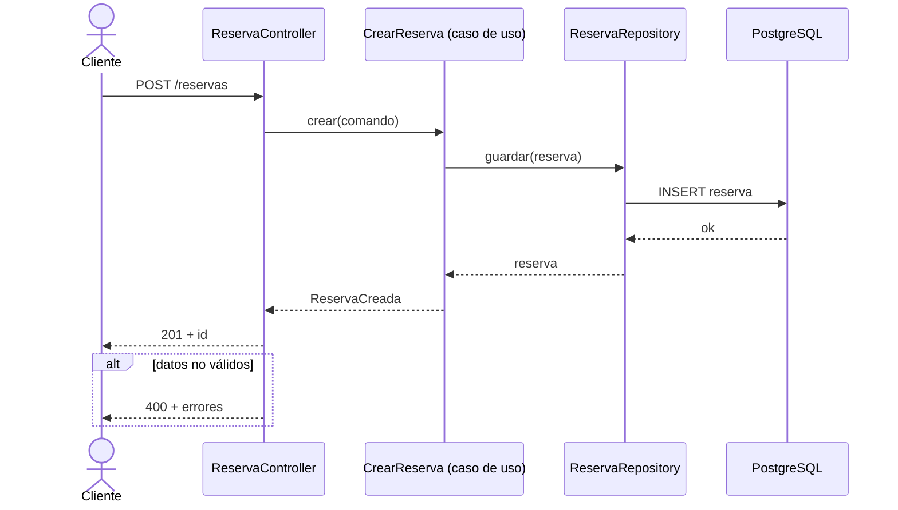

# Secuencia

Un diagrama **por flujo** (un endpoint, un caso de uso o un worker). Trazar cuesta lecturas de código: **nunca generes sin confirmación** ni encadenes varios diagramas sin preguntar por cada uno.

## 1. Acotar y preguntar
1. Localiza el punto de entrada (`@GetMapping`/`@PostMapping`…, `@JobWorker(type = …)`, listener). Si hay varios candidatos, pregunta cuál.
2. Si ya existe `brain/wiki/arquitectura/secuencias/<slug>.md`, mira su `commit:`: `git diff --stat <commit> -- <rutas de sources>`. Sin cambios → dilo y no regeneres.
3. Presenta el alcance en 3 líneas: punto de entrada, capas que se recorrerán, número aproximado de clases. Pregunta: «¿Lo genero?». Espera el sí.

## 2. Trazar (barato)
Delega en el subagente `explorador`: «sigue las llamadas desde `<Clase.método>` hasta la respuesta; devuelve en ≤ 25 líneas la cadena `Clase.método → Clase.método` con `archivo:línea`, qué devuelve cada paso, las ramas de error (excepciones, 4xx) y lo asíncrono (eventos, mensajes a Zeebe)». Con el plugin LSP de Java, mejor por símbolos que leyendo archivos. Para en los límites del sistema (BD, Zeebe, API externa): son participantes, no se entra en ellos.

## 3. Dibujar

- Participantes declarados en el orden de las capas: actor → adaptador de entrada → aplicación → dominio → puerto/adaptador de salida → sistema externo. Etiqueta con el nombre real de la clase.
- `->>` llamada, `-->>` respuesta, `-)` asíncrono (evento, mensaje a Zeebe). `alt`/`else` para el error que importa; `Note over` para lo que no se ve en las flechas (transacción, reintento, idempotencia).
- Mensajes cortos, con el nombre del método o la operación; **sin `:` dentro del texto** (rompe Mermaid). Como mucho ~15 mensajes: si hay más, agrupa con `Note` o divide en dos diagramas.
- No inventes participantes ni pasos que el trazado no haya visto; lo dudoso va en `Note over … : sin confirmar`.

## 4. Guardar
`brain/wiki/arquitectura/secuencias/<slug>.md` (p. ej. `post-reservas.md`), formato OKF:
```yaml
type: Secuencia
title: POST /reservas
description: <una frase: qué hace el flujo>
tags: [secuencia, <contexto acotado>]
sources:
  - { resource: <ruta del controlador>#L<línea> }      # una por clase del trazado
commit: <git rev-parse --short HEAD>                  # para saber si está desactualizado
generated: { by: agent:<modelo>, at: <AAAA-MM-DD> }
status: stable
```
Debajo: una línea de contexto, el bloque Mermaid y, si los hay, «Casos no dibujados». Enlázalo en `brain/wiki/arquitectura/index.md` (créalo si falta) y anota la entrada en `brain/wiki/log.md`.
