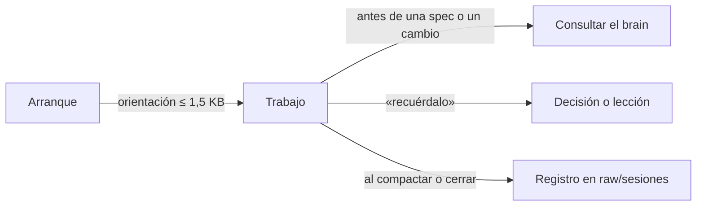
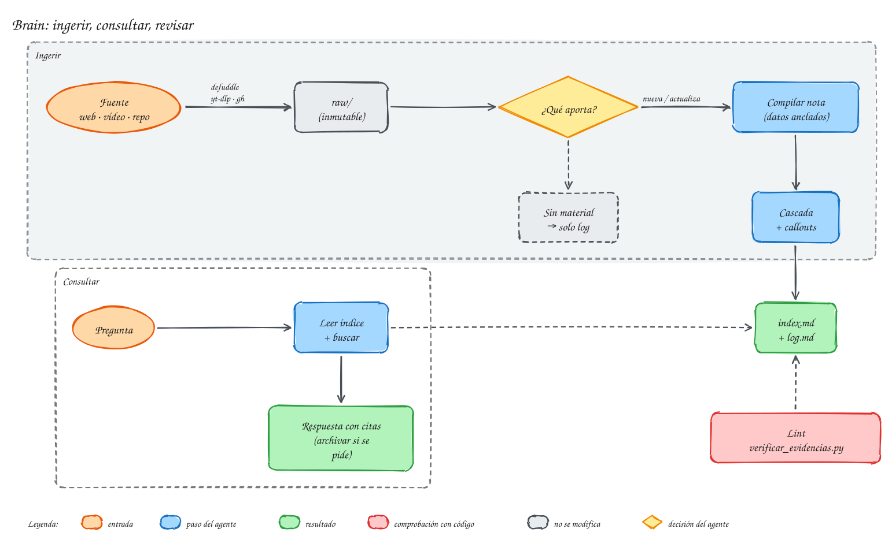

# El brain en Obsidian

El **[brain](../ayuda/glosario.md#brain)** es la memoria del proyecto: la carpeta `brain/` del repositorio, escrita en Markdown y pensada para abrirse como [bóveda](../ayuda/glosario.md#boveda) de Obsidian. El agente la consulta antes de decidir y la actualiza después; tú la lees, la navegas y apruebas lo que te toca.

Va **dentro del repositorio** y se versiona con el código. La [spec](../ayuda/glosario.md#spec) o el [FTD](../ayuda/glosario.md#ftd) de un cambio viajan en el mismo commit que el cambio, y quien haga `git pull` tiene la misma memoria que tú.

## Qué hay dentro
```text
brain/
├── index.md                    puerta de entrada: qué hay y dónde
├── raw/                        fuentes originales, no se editan
│   ├── fuentes/                documentación, artículos, transcripciones
│   └── sesiones/               registro de cada sesión (lo escriben los hooks)
├── wiki/                       conocimiento escrito por el agente
│   ├── index.md · log.md       catálogo e historial
│   ├── producto/               visión, usuarios y glosario del negocio
│   ├── arquitectura/           contextos, módulos, procesos, diagramas de secuencia
│   ├── decisiones/             decisiones del proyecto
│   ├── herramientas/           cómo se conecta y se prueba cada servicio externo
│   ├── conocimiento/           notas de fuentes externas
│   ├── lecciones/              lo aprendido (borrador hasta que lo revisas)
│   └── factoria/glosario.md    qué significan FTD, ASDD, riesgo…
├── factory/                    trabajo de la factoría
│   ├── constitucion.md         reglas fijas y definición de terminado
│   ├── revision.md             qué cuenta como fallo en una revisión
│   ├── decisiones-pendientes.md   la cola de decisiones
│   └── specs/ · planes/ · ftd/ · progreso/ · revisiones/ · verificaciones/
└── tableros/factoria.base      vista de specs, FTD y verificaciones por estado
```

| Carpeta | Quién escribe | Regla |
|---|---|---|
| `raw/` | el agente al guardar una fuente; los [hooks](../ayuda/glosario.md#hook), el registro de sesión | **no se edita**: es la prueba de dónde sale cada dato |
| `wiki/` | el agente, con la [skill](../ayuda/glosario.md#skill) `brain` | cada cifra o cita debe estar tal cual en la fuente que cita |
| `factory/` | el agente ([carriles](../ayuda/glosario.md#carril) FTD y [ASDD](../ayuda/glosario.md#asdd)) y tú (aprobaciones) | `progreso/` solo crece: se añaden líneas, no se reescriben |
| `tableros/` | el instalador | vistas de Obsidian, no contienen datos propios |

El `glosario.md` de `wiki/producto/` es el **[lenguaje ubicuo](../ayuda/glosario.md#lenguaje-ubicuo)** del proyecto: los términos del negocio con su significado. El agente lo consulta para nombrar clases y métodos como los nombra el negocio.

## Cómo se usa en cada sesión


- **Al arrancar**, un hook le pasa al agente la rama, el trabajo en curso (`factory/progreso/`) y las últimas entradas del historial. No carga el brain entero.
- **Antes de decidir**, el agente lee el índice, busca los términos y sus sinónimos y lee solo las notas que encuentra. Si responde con el brain, cita las notas.
- **Al decidir algo o aprender una lección**, basta con decir «recuérdalo»: la decisión va a `wiki/decisiones/` y la lección a `wiki/lecciones/` como borrador, hasta que la revisas.
- **Al compactar o cerrar la sesión**, un hook escribe en `raw/sesiones/` un registro con hechos sacados de git: commits, archivos tocados, documentos de la factoría. Nada del contenido de la conversación.

## Añadir conocimiento
Para que el brain sepa algo nuevo (la documentación de una API, un artículo, una reunión transcrita), pídeselo al agente: «ingiere esta página en el brain». La skill `brain` sigue estos pasos:

{ .mh-diagrama }

<small>Pulsa el diagrama para ampliarlo.</small>

1. Guarda la fuente original en `raw/`, sin tocarla.
2. Decide qué aporta: una nota nueva, una ampliación de una que existe, algo que contradice lo que había o nada nuevo.
3. Escribe o amplía la nota en `wiki/`, con cada dato copiado tal cual de la fuente.
4. Revisa las demás notas afectadas («cascada»). Lo que queda superado no se borra: se marca como desactualizado o en disputa con un [callout](../ayuda/glosario.md#callout).
5. Actualiza el índice y el historial.

Cada cierto tiempo conviene pedir un **[lint](../ayuda/glosario.md#lint)** del brain: un script comprueba que cada cifra y cada cita de `wiki/` aparecen en su fuente, y el agente busca contradicciones, notas huérfanas y notas caducadas.

## Abrirlo en Obsidian
Abre la carpeta **`brain/`** como bóveda, no el repositorio entero: así no ves código ni carpetas de compilación, y el grafo muestra solo conocimiento. El instalador deja una configuración mínima (enlaces Markdown relativos), y te conviene instalar el plugin **[Excalidraw](../ayuda/glosario.md#excalidraw)** para ver los diagramas.

Todas las notas siguen el formato **[OKF](../ayuda/glosario.md#okf)**: una cabecera ([frontmatter](../ayuda/glosario.md#frontmatter)) con tipo, título, descripción, etiquetas, fuentes y estado. Gracias a esa cabecera, el tablero `tableros/factoria.base` lista las specs, FTD y verificaciones por estado sin mantener nada a mano.

> [!tip] Si ya tienes tu propia bóveda
> Puedes enlazar la carpeta `brain/` del proyecto dentro de tu bóveda personal con un enlace simbólico. Obsidian lo admite, aunque no detecta al instante los cambios hechos desde fuera.
