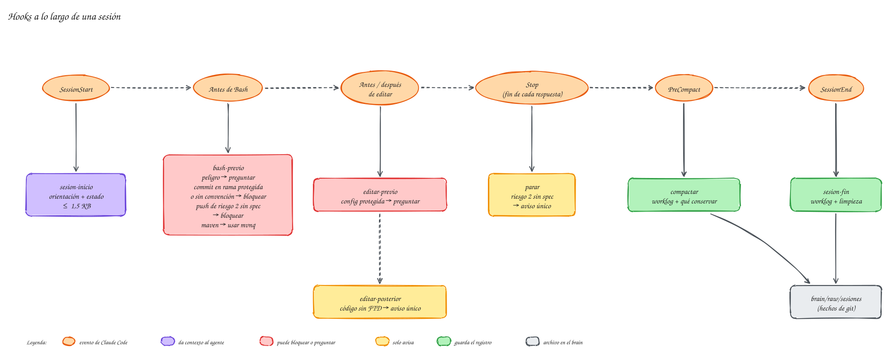

# Hooks y guardarraíles

Un **[hook](../ayuda/glosario.md#hook)** es un script que Claude Code ejecuta en un momento fijo de la sesión: al arrancar, antes de lanzar un comando, después de editar un archivo… Funciona **fuera del modelo**, así que no depende de que el agente recuerde una instrucción. **[meta-harness](../ayuda/glosario.md#meta-harness)** los usa para tres cosas: orientar al agente, impedir que se salte los procesos y dejar rastro en el [brain](../ayuda/glosario.md#brain).

Los hooks están en `.mh/hooks/` y se conectan en `.claude/settings.json`. Son scripts de [Node.js](../ayuda/glosario.md#nodejs) sin dependencias.

## Qué hook salta en cada momento
{ .mh-diagrama }

<small>Pulsa el diagrama para ampliarlo.</small>

| Momento | Hook | Qué hace |
|---|---|---|
| Al arrancar, tras `/clear` y tras compactar | `sesion-inicio` | Da al agente la orientación (cómo elegir [carril](../ayuda/glosario.md#carril), cómo responder) y el estado: rama, trabajo en curso, últimas entradas del brain. Todo en 1,5 KB como mucho. Avisa también si el proyecto ya tiene señales de un módulo que no está instalado |
| Antes de cada comando | `bash-previo` | Revisa el comando (abajo) |
| Antes de editar | `editar-previo` | Pide confirmación si el agente va a tocar la configuración de calidad (Checkstyle, PMD, SpotBugs, tests de [ArchUnit](../ayuda/glosario.md#archunit)), la del agente o la [constitución](../ayuda/glosario.md#constitucion): «corrige el código, no las reglas» |
| Después de editar | `editar-posterior` | Si se edita código sin un [FTD](../ayuda/glosario.md#ftd) ni una [spec](../ayuda/glosario.md#spec) en curso, avisa una vez por sesión |
| Al terminar cada respuesta | `parar` | Si hay cambios de [riesgo](../ayuda/glosario.md#riesgo) 2 sin spec aprobada, avisa al agente para que te lo diga. Ve también los cambios hechos con comandos, que los hooks de edición no detectan |
| Al compactar | `compactar` | Escribe el registro de la sesión y le dice al resumen qué debe conservar: carril, documento, tarea, decisiones, controles |
| Al cerrar | `sesion-fin` | Escribe el registro de la sesión y limpia los temporales |

### Lo que revisa antes de cada comando
`bash-previo` hace varias comprobaciones en un solo proceso, para no lanzar un script por cada una:

| Comprobación | Cuándo salta | Qué hace |
|---|---|---|
| `peligro` | comandos destructivos: `rm -rf` sobre una ruta raíz, `git push --force`, `git reset --hard`, `DROP TABLE`, `DELETE` sin `WHERE`, `docker compose down -v`, `mvn deploy`… | **te pide confirmación** |
| `puerta-riesgo` | `git push`, o crear o integrar un [PR](../ayuda/glosario.md#pr) con `gh` o `glab`, con cambios de riesgo 2 sin spec aprobada y revisión aprobada | **bloquea** y explica qué falta |
| `rama-protegida` | `git commit` en una [rama protegida](../ayuda/glosario.md#rama-protegida) (`main`, `develop`…) | **bloquea** y propone crear una rama |
| `convencion-commit` | `git commit` con un mensaje que no sigue la convención del proyecto | **bloquea** y da un ejemplo válido |
| `maven` | `mvn verify`, `test`, `package` o `install` sin filtrar | **bloquea** y da el mismo comando con [`mvnq`](../tokens/mvnq.md) |

Las salidas reales de la puerta de riesgo y del aviso al terminar están en [riesgo y revisión](../uso/riesgo-revision.md#las-dos-redes-de-seguridad).

## Cómo se comportan
- **Fallo en abierto.** Si un hook falla por un error propio (un JSON roto, git que no está instalado), sale sin decidir nada. Un hook averiado nunca te deja sin poder trabajar ([fallo en abierto](../ayuda/glosario.md#fallo-en-abierto)).
- **Cada bloqueo dice cómo seguir**: qué falta y qué [skill](../ayuda/glosario.md#skill) o comando usar. El agente lo lee y corrige su camino.
- **Preguntar antes que bloquear** cuando la acción puede ser legítima: un comando destructivo o un cambio en la configuración de calidad pueden ser justo lo que quieres hacer.
- **Solo actúan sobre el agente.** En tu terminal, `git push` y `mvn verify` funcionan como siempre.
- **El registro de la sesión guarda hechos**, no conversación: datos de git y rutas de la factoría, en `brain/raw/sesiones/`.
- **Avisan una vez.** Los avisos (código sin FTD, riesgo 2 sin spec) no se repiten en cada respuesta: cada uno ocuparía contexto.

## Ajustarlos
En `.mh.json`, en la raíz del proyecto:

```json
{
  "perfil": "standard",
  "desactivados": ["aviso-ftd"],
  "protegidos": ["**/reglas-negocio.yml"]
}
```

- **`perfil`**: `minimal` deja solo la orientación de arranque y la comprobación de comandos peligrosos; `standard` (el normal) activa todo.
- **`desactivados`**: comprobaciones que no quieres, por su nombre (`peligro`, `puerta-riesgo`, `rama-protegida`, `convencion-commit`, `maven`, `proteger-config`, `aviso-ftd`, `aviso-riesgo`, `worklog`, `sesion-inicio`).
- **`protegidos`**: archivos propios de tu proyecto que el agente no debe tocar sin preguntar.

Para una sola sesión, sin tocar la configuración:

```bash
MH_DESACTIVAR=maven,aviso-ftd claude    # desactiva esas comprobaciones en esta sesión
MH_DEBUG=1 claude                        # muestra los errores internos de los hooks
```

La tabla de riesgo, que deciden `puerta-riesgo` y `parar`, también se ajusta en `.mh.json`: ver [riesgo y revisión](../uso/riesgo-revision.md#ajustar-la-tabla-a-tu-proyecto).

> [!warning] `.mh.json` y `.claude/` son riesgo 2
> Cambiar la configuración de los hooks es cambiar las reglas del agente. Si se lo pides al agente, te pedirá confirmación; si lo haces tú, súbelo con su propio commit.
