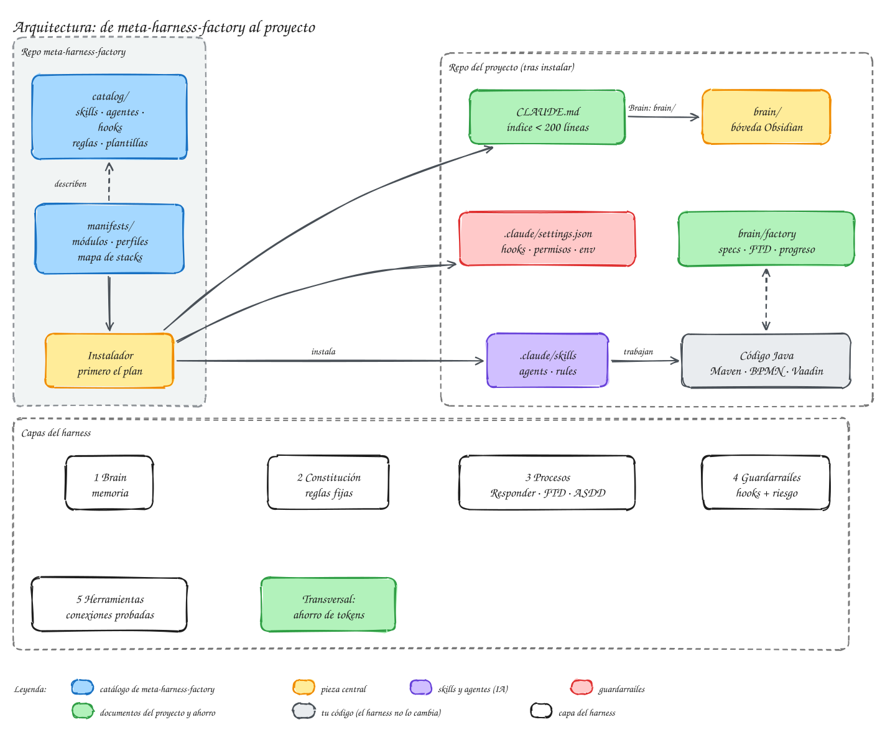

# Arquitectura

Esta sección explica **cómo está hecho [meta-harness](../ayuda/glosario.md#meta-harness) por dentro**: de qué piezas se compone, dónde queda cada una en tu proyecto y por qué está ahí. No hace falta leerla para trabajar con él (para eso están el [tutorial](../tutorial/index.md) y el [uso diario](../uso/index.md)), pero sí ayuda cuando quieres ajustarlo, entender un aviso o saber cuánto contexto gasta.

## Modelo, harness y meta-harness
Un **[harness](../ayuda/glosario.md#harness)** («arnés») es todo lo que rodea al modelo de lenguaje para que trabaje bien en un proyecto: instrucciones, memoria, herramientas, comprobaciones. Claude Code ya es un harness genérico. **meta-harness** es el sistema que **monta un harness a medida en cada proyecto**: no se instala una vez para todos, sino que mira cada proyecto y copia en él solo las piezas que necesita.

{ .mh-diagrama }

<small>Pulsa el diagrama para ampliarlo.</small>

Se compone de dos partes:

- **El catálogo** (`catalog/`): las piezas disponibles. [Skills](../ayuda/glosario.md#skill) (instrucciones que el agente carga cuando las necesita), [subagentes](../ayuda/glosario.md#subagente) (revisores, desarrollador, explorador…), [hooks](../ayuda/glosario.md#hook) (scripts que Claude Code ejecuta en momentos fijos), reglas y plantillas. Las piezas se agrupan en [módulos](modulos.md).
- **El instalador** (`installer/mh.mjs`): pregunta, analiza el proyecto, enseña un plan y, si lo aceptas, copia las piezas elegidas. Después sirve para comprobar, reevaluar, actualizar o desinstalar.

Una vez instalado, el proyecto **no depende de meta-harness**: todo lo necesario queda dentro del repositorio y se versiona con el código.

## Tres ideas que guían el diseño
1. **Lo que es algoritmo va en código.** Una instrucción («calcula el [riesgo](../ayuda/glosario.md#riesgo) antes de subir») el agente puede olvidarla; un hook que bloquea el `git push` no se olvida. Por eso lo que se puede comprobar con un script lo hace un script, y al modelo se le deja lo que necesita criterio.
2. **El contexto es un presupuesto.** Todo lo que el agente lee ocupa contexto y cuesta [tokens](../ayuda/glosario.md#token), y lo que está siempre cargado se paga en cada mensaje. Lo [siempre activo](../ayuda/glosario.md#siempre-activo) es corto y está medido; lo demás se carga solo cuando hace falta.
3. **La memoria vive en el repositorio.** Decisiones, [specs](../ayuda/glosario.md#spec), evidencias y lecciones van al [brain](../ayuda/glosario.md#brain), una carpeta de Markdown que se abre en Obsidian y viaja con el código. Lo que sabe el agente lo sabe también el equipo.

## En esta sección
| Página | Qué explica |
|---|---|
| [Las cinco capas](capas.md) | memoria, reglas, procesos, guardarraíles y herramientas: qué pieza implementa cada una y cuándo se carga |
| [El brain en Obsidian](brain.md) | la estructura de `brain/`, quién escribe en cada carpeta y cómo se usa en cada sesión |
| [Hooks y guardarraíles](hooks.md) | qué hook salta en cada momento, qué comprueba y cómo se ajusta |
| [Módulos del catálogo](modulos.md) | qué módulos hay, qué señales los activan y qué instala cada uno |
