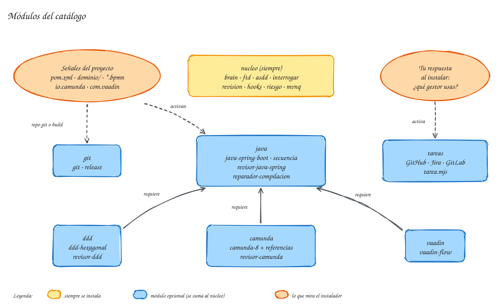

# Módulos del catálogo

El catálogo agrupa sus piezas en **módulos**. El **núcleo** se instala siempre; los demás solo si el proyecto los necesita. Así, un proyecto sin Camunda no carga la [skill](../ayuda/glosario.md#skill) ni el revisor de Camunda, y no paga su contexto.

{ .mh-diagrama }

<small>Pulsa el diagrama para ampliarlo.</small>

## Qué instala cada módulo
| Módulo | Se propone si… | Skills | [Subagentes](../ayuda/glosario.md#subagente) | Reglas |
|---|---|---|---|---|
| **nucleo** | siempre | `brain`, `ftd`, `asdd`, `revision`, `interrogar`, `obsidian-markdown`, `excalidraw`, `obsidian-bases`, `defuddle` | `especificador`, `desarrollador`, revisores de corrección, tests y seguridad, `verificador-hallazgos`, `explorador`, `ejecutor-tests` | `brain` |
| **java** | hay `pom.xml` o Gradle con Spring Boot | `java-spring-boot`, `secuencia` | `revisor-java-spring`, `reparador-compilacion` | `java`, `migraciones` |
| **ddd** | hay carpetas `dominio/` o `domain/`, o jMolecules | `ddd-hexagonal` | `revisor-ddd` | `dominio` |
| **camunda** | hay `*.bpmn` o `*.dmn`, o dependencias de Camunda | `camunda-8` y la documentación oficial de Camunda | `revisor-camunda` | `camunda` |
| **vaadin** | hay dependencias de Vaadin | `vaadin-flow` | — | `vaadin` |
| **git** | hay repositorio git o un archivo de build | `git`, `release` | — | — |
| **tareas** | dices al instalar que usas GitHub Issues, Jira o GitLab | `tareas` | — | — |

El núcleo incluye además los [hooks](hooks.md) y los scripts `riesgo.mjs` y `mvnq.mjs`; el módulo **tareas** añade `tarea.mjs`. Los módulos **ddd**, **camunda** y **vaadin** requieren **java**: si el instalador propone uno, propone también java.

## Qué aporta cada pieza de stack
- **`java-spring-boot`**: Java moderno (records, sealed), inyección por constructor, transacciones en el caso de uso, `ProblemDetail`, JPA sin consultas N+1, tests por capa ([Testcontainers](../ayuda/glosario.md#testcontainers) incluido) y migraciones Flyway que nunca se editan una vez aplicadas.
- **`secuencia`** (manual, `/secuencia <endpoint o flujo>`): dibuja en [Mermaid](../ayuda/glosario.md#mermaid) el [diagrama de secuencia](../ayuda/glosario.md#diagrama-de-secuencia) de un flujo real del código, siguiendo las llamadas con el `explorador`, y lo guarda en el [brain](../ayuda/glosario.md#brain).
- **`ddd-hexagonal`**: estructura de paquetes, reglas de agregados y objetos valor, una transacción por agregado y un test de [ArchUnit](../ayuda/glosario.md#archunit) con las reglas de [jMolecules](../ayuda/glosario.md#jmolecules) y de arquitectura hexagonal.
- **`camunda-8`**: workers finos e [idempotentes](../ayuda/glosario.md#idempotencia), los tres tipos de fallo (error de negocio, reintento técnico, incidente), variables y [BPMN](../ayuda/glosario.md#bpmn-dmn) como contrato con las [instancias en vuelo](../ayuda/glosario.md#instancia-en-vuelo) y tests de proceso. Para el detalle de la API usa la documentación oficial de Camunda, copiada en el proyecto ([referencias de proveedor](../ayuda/glosario.md#referencia-de-proveedor)).
- **`vaadin-flow`**: vistas como adaptadores, seguridad en cada ruta, `Binder` y tests sin navegador.
- **`git`** y **`release`**: commits con la convención que elijas al instalar, ramas con tu formato, [PR](../ayuda/glosario.md#pr) con plantilla; `/release` calcula la versión ([SemVer](../ayuda/glosario.md#semver)) a partir de los commits y escribe el CHANGELOG.
- **`tareas`**: trabajar desde una tarea del [gestor](../ayuda/glosario.md#gestor-de-tareas) («Empieza la tarea #23») y, en [ASDD](../ayuda/glosario.md#asdd), crear las tareas del plan. Ver [trabajar desde una tarea](../uso/ftd.md#trabajar-desde-una-tarea-del-gestor).

Cada revisor de stack **precarga su skill**: revisa con las mismas reglas con las que se escribió el código.

## Cómo se cargan sin gastar contexto
Las skills de stack llevan `paths`: Claude Code solo las ofrece al agente cuando trabaja con archivos de su terreno. La de Camunda, por ejemplo, se activa con `*.bpmn`, `*.dmn`, `*.form`, `*Worker*.java` o la carpeta `camunda/`. Las reglas funcionan igual.

Las skills que solo tienen sentido cuando las pides (`/interrogar`, `/secuencia`, `/release`, `defuddle`, `obsidian-bases`) son **manuales**: su descripción no se carga en cada sesión. Con todos los módulos instalados, el proyecto queda por debajo de 12 skills automáticas.

## Cuando el proyecto cambia
El instalador guarda en `.mh.json` las señales de los módulos que **no** instaló. Si un día aparece el primer `.bpmn` o la dependencia de Vaadin, el [hook](../ayuda/glosario.md#hook) de arranque lo detecta y el agente te propone ejecutar `mh reevaluar`, que enseña qué módulos añadir sin instalar nada todavía. Cómo se reevalúa, se actualiza o se desinstala está en [mantenimiento](../ayuda/mantenimiento.md).
