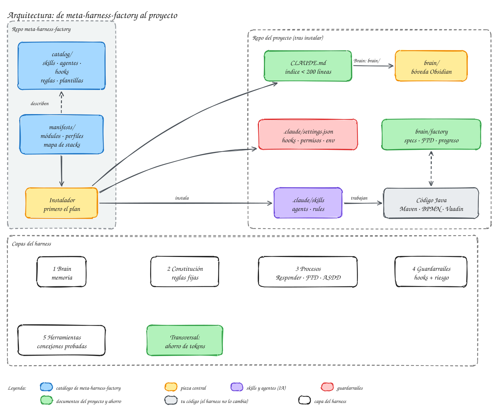

# meta-harness-factory

Tu software factory con Claude Code: memoria en Obsidian, procesos que se cumplen y menos tokens.

[Empezar el tutorial :material-arrow-right:](tutorial/index.md){ .md-button .md-button--primary } [Entender la arquitectura](arquitectura/index.md){ .md-button }

Un modelo de IA sin nada alrededor empieza cada sesión sin memoria, rellena huecos con suposiciones y da por terminado lo que no está probado. **meta-harness-factory** monta en cada proyecto, a medida, lo que Claude Code necesita para trabajar como una pequeña factoría de software: memoria del proyecto, carriles de trabajo, revisores, controles automáticos y un presupuesto de contexto medido.

-   :material-sign-direction:{ .lg .middle } **Tres carriles de trabajo**

    ---

    Cada petición va por el camino que pide: **responder**, **FTD** para cambios claros o **ASDD** para cambios con decisiones, con tu aprobación en los puntos clave.

    [:octicons-arrow-right-24: Uso diario](uso/index.md)

-   :material-brain:{ .lg .middle } **Brain en Obsidian**

    ---

    La memoria del proyecto vive en `brain/`, una bóveda de Obsidian versionada con el código: decisiones, specs, evidencias y lecciones que el agente consulta antes de actuar.

    [:octicons-arrow-right-24: El brain](arquitectura/brain.md)

-   :material-shield-check:{ .lg .middle } **Reglas que se cumplen**

    ---

    Los hooks calculan el riesgo de cada cambio, frenan los comandos peligrosos y exigen spec y revisión antes de integrar lo delicado (procesos BPMN, migraciones, seguridad).

    [:octicons-arrow-right-24: Riesgo y revisión](uso/riesgo-revision.md)

-   :material-cash-minus:{ .lg .middle } **Menos tokens, medido**

    ---

    Lo siempre cargado tiene presupuesto, Maven devuelve solo lo esencial y el trabajo pesado se reparte entre modelos. En una spec real, el ajuste del harness redujo el coste un 59 %.

    [:octicons-arrow-right-24: Ahorro de tokens](tokens/index.md)

## Cómo encaja

{ .mh-diagrama }

El **catálogo** contiene skills, subagentes, hooks, reglas y plantillas. El **instalador** te hace unas preguntas (el tipo de proyecto, cómo trabajas con git, tu gestor de tareas…), analiza tu proyecto y te enseña un plan; solo cuando lo aceptas copia al proyecto las piezas elegidas.

## Para quién es

Para quien desarrolla con **Claude Code** y quiere que el agente trabaje con método en proyectos **Java con Spring Boot**, **DDD hexagonal**, **Camunda 8 / BPMN** y **Vaadin**, usando **Obsidian** como segundo cerebro. El núcleo (memoria, carriles, revisión, hooks) sirve para cualquier proyecto; los módulos de stack se instalan solo si el proyecto los usa.

!!! tip "¿Por dónde empiezo?"
    Si es tu primera vez, sigue el [tutorial](tutorial/index.md): en unos minutos tendrás el harness instalado en un proyecto y habrás hecho tu primer cambio con él.
