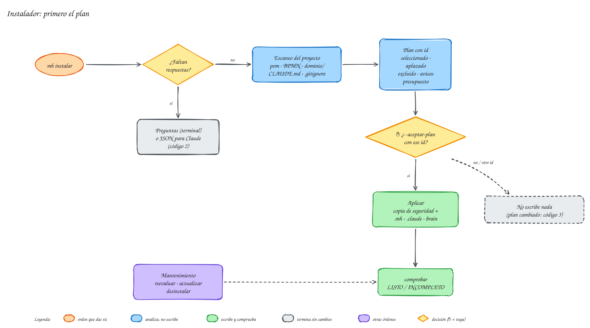

# Instalar en un proyecto

La instalación sigue el principio de **[primero el plan](../ayuda/glosario.md#primero-el-plan)**: el instalador te hace unas preguntas, analiza el proyecto y te enseña exactamente qué va a instalar y qué va a cambiar. **No escribe nada** hasta que aceptas ese plan.

{ .mh-diagrama }

<small>Pulsa el diagrama para ampliarlo.</small>

## 1. Prepara meta-harness-factory y el proyecto de ejemplo
El tutorial usa **[Spring PetClinic](https://github.com/spring-projects/spring-petclinic)**, la aplicación de ejemplo oficial de Spring (licencia Apache-2.0): un monolito con Spring Boot, Maven y tests. Así puedes reproducir cada paso tal cual.

```bash
git clone <url-del-repositorio> ~/meta-harness-factory
git clone https://github.com/spring-projects/spring-petclinic.git ~/proyectos/spring-petclinic
```
**[meta-harness-factory](../ayuda/glosario.md#meta-harness)** no necesita instalar dependencias: el instalador solo usa [Node.js](../ayuda/glosario.md#nodejs). Con tu propio proyecto, el proceso es el mismo.

## 2. Lanza el instalador
```bash
node ~/meta-harness-factory/installer/mh.mjs instalar --carpeta ~/proyectos/spring-petclinic
```

> [!info]- ¿Qué es `mh.mjs` y por qué se ejecuta con `node`?
> **Node.js** es el entorno que ejecuta programas escritos en JavaScript fuera del navegador: para JavaScript es lo que la JVM para Java. La extensión **`.mjs`** indica un archivo JavaScript escrito como *módulo ES* (el sistema estándar de módulos, con `import`/`export`); Node.js lo ejecuta directamente, sin compilar ni instalar paquetes. *mh* son las iniciales de **meta-harness-factory**. Se eligió Node.js porque funciona igual en Linux, macOS y Windows y los [hooks](../ayuda/glosario.md#hook) de Claude Code se escriben de forma natural en él; meta-harness-factory no usa ningún paquete externo.

> [!tip] También puedes pedírselo a Claude
> En una sesión de Claude Code dentro del proyecto: «instala **meta-harness-factory** en este proyecto». El instalador le devuelve las preguntas que faltan y Claude **te las hace a ti**: tiene prohibido deducirlas del código.

## 3. Responde las preguntas
| Pregunta | Opciones | Qué cambia |
|---|---|---|
| Cómo te habla el agente | técnico · sencillo | «sencillo»: explica con analogías y sin jerga |
| Tipo de proyecto | microservicios · orquestación de procesos · UI Vaadin · monolito modular · librería · otro | ayuda a elegir módulos |
| Objetivo | una frase | la descripción del `CLAUDE.md` |
| Alcance | pequeño · creciente · complejo | pequeño = controles mínimos |
| Integración | ramas y [PR](../ayuda/glosario.md#pr) · directo en la rama principal | con ramas, las ramas base quedan protegidas |
| Convención de commits | [Conventional Commits](../ayuda/glosario.md#conventional-commits) · Conventional + gitmoji | lo que exige el hook de commits |
| Formato de rama | `57-fix-reset-cliente` · `fix/57-reset-cliente` · `fix/reset-cliente` | cómo nombra el agente las ramas |
| [Gestor de tareas](../ayuda/glosario.md#gestor-de-tareas) | ninguno · GitHub Issues · Jira · GitLab Issues | de dónde salen las tareas |
| (Jira) Clave del proyecto | p. ej. `RES` | búsquedas y creación de tareas |
| (con gestor) Acceso | [CLI](../ayuda/glosario.md#cli) · [MCP](../ayuda/glosario.md#mcp) | CLI recomendada: gasta menos [tokens](../ayuda/glosario.md#token) |

## 4. Lee el plan
Este es el plan **real** para PetClinic con estas respuestas: técnico · otro · creciente · ramas y PR · Conventional Commits · ramas `{tipo}/{slug}` · sin gestor de tareas.

```text
Plan de instalación 5499c298c74a · meta-harness-factory 0.1.0 · proyecto petclinic · perfil standard

Módulos:
  ✔ nucleo   seleccionado — siempre
  ✔ java     seleccionado — build maven con Spring Boot
  ⏸ ddd      aplazado — sin señales todavía (se propondrá si aparece un paquete dominio/ o la dependencia jmolecules)
  ⏸ camunda  aplazado — sin señales todavía (se propondrá si aparece un .bpmn/.dmn o la dependencia io.camunda)
  ✔ git      seleccionado — repositorio git
  ✖ tareas   excluido — sin gestor de tareas elegido
  ⏸ vaadin   aplazado — sin señales todavía (se propondrá si aparece la dependencia com.vaadin)

Componentes:
  skills (11): brain, ftd, asdd, revision, obsidian-markdown, obsidian-bases (manual), defuddle (manual),
               excalidraw, java-spring-boot, git, release (manual)
  subagentes (10): especificador, desarrollador, revisor-correccion, revisor-tests, revisor-seguridad,
                   verificador-hallazgos, explorador, ejecutor-tests, revisor-java-spring, reparador-compilacion
  reglas con paths (3): brain, java, migraciones

Archivos:
  crear             .mh/ — hooks, scripts, orientación y referencias
  crear             .mh.json — configuración y plan aceptado
  crear             .claude/settings.json — hooks y permisos (se conservan los tuyos)
  crear             CLAUDE.md — índice corto desde plantilla
  crear             init.sh — arranque y smoke test
  crear             brain/ — solo se crean los archivos que falten; nunca se sobrescribe
  añadir-lineas     .gitignore — .mh/tmp/ y .mh/backups/
  copiar            .claude/skills/ — 11 skills
  copiar            .claude/agents/ — 10 subagentes
  copiar            .claude/rules/ — 3 reglas

Presupuesto siempre activo:
  CLAUDE.md ~28 líneas · orientación 803 B (+ estado, máx. 1500 B al arrancar)
  8 skills automáticas (1927 caracteres de descripción) · subagentes 1515 car. · reglas siempre activas: 0

No se ha escrito nada. Para aplicar exactamente este plan:
  node ~/meta-harness-factory/installer/mh.mjs instalar --carpeta ~/proyectos/spring-petclinic … --aceptar-plan 5499c298c74a
```

Cómo leerlo:

- **✔ seleccionado / ⏸ aplazado / ✖ excluido**, cada uno con su motivo. Lo aplazado dice qué tendría que aparecer para proponerlo (más adelante te lo avisa `mh reevaluar`, ver [mantenimiento](../ayuda/mantenimiento.md)).
- **Presupuesto [siempre activo](../ayuda/glosario.md#siempre-activo)**: lo que el agente lee en *cada* petición. Cuanto menos, más barato y más espacio útil.
- **Avisos**: problemas detectados con su solución (sin git, CLI sin sesión, `CLAUDE.md` demasiado largo, sin tests…). PetClinic no tiene ninguno.
- **Lo aplazado**: PetClinic no usa [DDD](../ayuda/glosario.md#ddd), Camunda ni Vaadin; en un proyecto que los use, esos módulos aparecen seleccionados (lo verás en [uso diario](../uso/index.md)).
- El **identificador** es una huella del plan: si el proyecto o tus respuestas cambian antes de aceptarlo, no coincide y no se escribe nada. El tuyo será distinto (depende, entre otras cosas, del nombre de la carpeta).

> [!note] Tus skills y agentes no se tocan
> Si ya tienes una [skill](../ayuda/glosario.md#skill) o un agente con el mismo nombre que uno del catálogo, el plan lo marca como excluido. Tu `CLAUDE.md` recibe solo un bloque entre `<!-- mh:inicio -->` y `<!-- mh:fin -->`, y tus hooks y permisos de `settings.json` se conservan.

## 5. Acepta el plan
Copia la orden que imprime el plan (incluye tus respuestas y el identificador):
```bash
node ~/meta-harness-factory/installer/mh.mjs instalar --carpeta ~/proyectos/spring-petclinic … --aceptar-plan 5499c298c74a
```
```text
Plan 5499c298c74a aplicado: 39 elementos escritos; copia de seguridad en .mh/backups/….
Estado: LISTO
Presupuesto real: CLAUDE.md 31 líneas · orientación 803 B · 8 skills automáticas (1927 car.) · 10 subagentes (1515 car.) · reglas siempre activas 0
```
Todo lo que se modifica se copia antes a `.mh/backups/`.

## 6. Qué se ha creado
```text
spring-petclinic/
├── CLAUDE.md              índice nuevo (PetClinic no tenía); en un proyecto con CLAUDE.md propio, solo se añade un bloque
├── init.sh                arranque y smoke test (la infraestructura detectada queda comentada para que la actives tú)
├── .mh.json               tu configuración: respuestas, perfil, git, tareas, riesgo
├── .mh/                   hooks, scripts (riesgo, mvnq, tarea), orientación, skills
├── .claude/
│   ├── settings.json      hooks conectados (se conservan los tuyos)
│   ├── skills/            skills elegidas (copias; funcionan igual en Windows, Linux y macOS)
│   ├── agents/            subagentes: especificador, desarrollador, revisores…
│   └── rules/             reglas que solo se cargan al tocar ciertos archivos
└── brain/                 la memoria del proyecto (bóveda de Obsidian)
```

## 7. Comprueba y haz commit
```bash
node ~/meta-harness-factory/installer/mh.mjs comprobar --carpeta ~/proyectos/spring-petclinic
git add -A && git commit -m "chore: instalar meta-harness-factory"
```
`comprobar` responde **LISTO** o **INCOMPLETO** con los motivos y mide el presupuesto real.

El `CLAUDE.md` creado es un índice corto con los paquetes reales del proyecto:
```markdown
# petclinic

Aplicación de ejemplo de Spring para gestionar una clínica veterinaria

Brain: brain/   (memoria del proyecto: consulta brain/wiki/index.md antes de decidir; skill `brain`)

## Mapa
| Ruta | Qué hay |
|---|---|
| `src/main/java/org/springframework/samples/petclinic/model/` | paquete |
| `src/main/java/org/springframework/samples/petclinic/owner/` | paquete |
| `src/main/java/org/springframework/samples/petclinic/system/` | paquete |
| `src/main/java/org/springframework/samples/petclinic/vet/` | paquete |
| `brain/` | memoria y factoría (bóveda de Obsidian) |
```

## 8. Abre el brain en Obsidian
Abre la carpeta `brain/` como [bóveda](../ayuda/glosario.md#boveda) (no el repositorio entero: así no ves código). Empieza por `index.md` y revisa con el agente la **[constitución](../ayuda/glosario.md#constitucion)** (`brain/factory/constitucion.md`): es un borrador con el stack detectado que conviene completar.

## 9. Tu primera sesión
Abre Claude Code en el proyecto. Antes de tu primer mensaje, el agente ya ha recibido una orientación breve:

```text
[meta-harness-factory] Carril de cada petición (anúncialo en una línea; el usuario puede corregirlo):
- Pide información → RESPONDER …
- Cambio claro sin decisiones abiertas → FTD …
- Decisiones abiertas, ambigüedad o riesgo 2 → ASDD …
Rama: main
Último en el brain: * Creación: brain inicializado por meta-harness-factory 0.1.0.
```

Siguiente: [tu primer cambio](primer-ftd.md).
