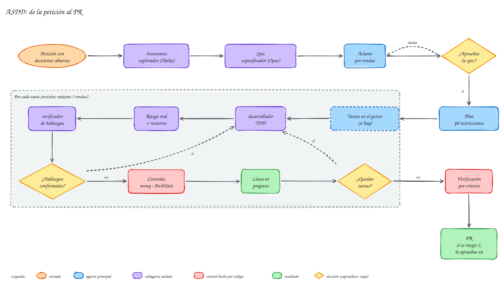
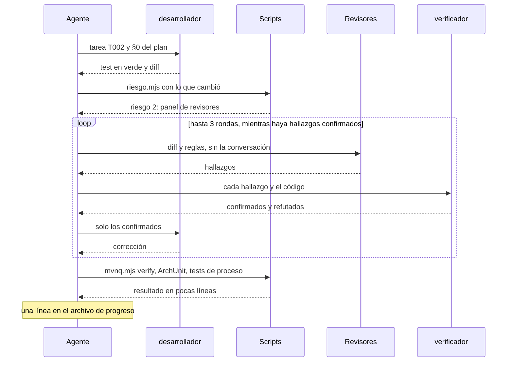

# ASDD: cambios con decisiones

**[ASDD](../ayuda/glosario.md#asdd)** (*Agent Spec Driven Development*, desarrollo guiado por especificaciones) es el [carril](../ayuda/glosario.md#carril) para cambios donde **un supuesto equivocado sale caro**: una capacidad nueva, un proceso [BPMN](../ayuda/glosario.md#bpmn-dmn), el modelo de dominio, una migración, la seguridad. La regla de oro: **ningún código antes de que apruebes la [spec](../ayuda/glosario.md#spec)**.

## Los pasos
{ .mh-diagrama }

| Paso | Qué pasa | Quién | Documento en `brain/factory/` |
|---|---|---|---|
| 0 | [Constitución](../ayuda/glosario.md#constitucion) del proyecto (una vez) | tú y el agente | `constitucion.md`, `revision.md` |
| 1 | **Spec**: inventario de lo afectado, [riesgo](../ayuda/glosario.md#riesgo) y la spec | agente ([subagentes](../ayuda/glosario.md#subagente) `explorador` y `especificador`) | `specs/<tema>.md` |
| 2 | **Aclarar**: resuelves los puntos abiertos y ✋ **apruebas** | tú | la misma spec, `estado: aprobada` |
| 3 | **Plan y tareas** | agente | `planes/<tema>.md` |
| 4 | **Bucle por tarea**: [TDD](../ayuda/glosario.md#tdd), riesgo, revisión, controles | agente y subagentes | `progreso/<tema>.md` |
| 5 | **Cierre**: verificación final, evidencia y [PR](../ayuda/glosario.md#pr) (✋ lo apruebas si es riesgo 2) | agente y tú | `verificaciones/<tema>-<fecha>.md` |

## Un ejemplo real: workers que no aguantan un reintento
En el proyecto de reservas de viaje se pidió: «haz [idempotentes](../ayuda/glosario.md#idempotencia) los workers del servicio de clientes y que solo lleguen al BPMN los errores de negocio». Es un ASDD de libro: hay decisiones abiertas (¿cómo se detecta un reintento?) y el riesgo es 2 (afecta al contrato de los procesos).

### 1. La spec
Primero, un subagente barato (`explorador`, que usa un modelo de lenguaje pequeño, Haiku) hizo un **inventario**: los 15 workers del servicio, qué escribe cada uno y quién captura sus errores en los BPMN. Con ese inventario, el subagente `especificador` (con Opus, el modelo más capaz y más caro) redactó la spec. Lo más valioso que encontró fue un **fallo grave que nadie había pedido buscar**:

> Si un worker confirma el cambio en la base de datos pero la confirmación del job se pierde, [Zeebe](../ayuda/glosario.md#zeebe) lo reentrega. En el reintento, el cliente ya está en el estado destino, la transición «de ACTIVO a ACTIVO» se rechaza, el error lo captura el *catch-all* del subproceso de pago y se ejecuta **la compensación de una reserva ya pagada**.

La spec responde siempre **cuatro preguntas**:

| Pregunta | En el ejemplo |
|---|---|
| 1. ¿Qué podrá hacer el usuario? | El motor podrá reentregar cualquier job, incluso varias veces, sin consecuencias |
| 2. ¿Qué resultado observable obtiene? | Reentrega tras éxito → mismo estado y mismas variables. Error de negocio → el mismo código que hoy. Fallo técnico → reintento con espera e incidente en Operate, nunca el camino de negocio |
| 3. ¿Qué debe respetar? | Los 15 job types, los códigos de error y los BPMN desplegados no cambian; el dominio sigue sin Spring; no se debilita ningún test |
| 4. ¿Cómo se demuestra? | Un test unitario por worker, un test de integración «mismo job dos veces» por cada worker que escribe y, si se aprueba, tests de proceso |

Cada **criterio de aceptación** lleva su prueba. Por ejemplo:

```markdown
- CA2 (idempotencia, sin duplicar) Dado un cliente con N tarjetas, cuando actualizar-registro-cliente
  se ejecuta dos veces con el mismo job y la misma tarjeta, entonces el cliente tiene N+1 tarjetas
  y las dos ejecuciones devuelven el mismo tarjetaId.
  Prueba: ActualizarRegistroClienteWorkerIT.mismoJobDosVeces_noDuplicaTarjeta
```

La spec incluye además el **coste de no hacerlo**, la **alternativa más barata** (y por qué no basta) y lo que queda **fuera** del cambio.

### 2. Aclarar: los puntos abiertos
El agente **no rellena huecos con supuestos**. Lo que no está claro va a una tabla de puntos abiertos, cada uno con su tipo y una recomendación:

| # | Tipo | Punto (resumido) | Recomendación del agente |
|---|---|---|---|
| P1 | pregunta | ¿Cómo se detecta un reintento? A) por el estado del dominio, B) guardando el `jobKey`, C) A más el id de la reserva | depende del worker; razonado en la spec |
| P6 | pregunta | ¿Cuánto espera un reintento técnico? | espera exponencial en un clasificador común |
| P7 | supuesto tomado | «Misma salida» excluye las marcas de tiempo | — |
| P8 | pregunta | ¿Se añaden tests de proceso? (toca el `pom.xml`: riesgo 2) | sí, en el servicio que tiene los BPMN |
| P9 | pregunta | ¿Una PR o varias? | varias: primero el patrón con un worker, luego por grupos |
| P10 | decisión aplazada | Desajustes BPMN ↔ worker encontrados por el camino | otra spec |

El agente pregunta **por rondas**: en cada una, solo los puntos que ya se pueden decidir, numerados y con su respuesta recomendada redactada para que te baste con contestar «sí». Lo que se puede averiguar mirando el código o el [brain](../ayuda/glosario.md#brain) lo averigua él; a ti solo te llegan decisiones. Al responder, puede que se abran puntos nuevos, que van en la ronda siguiente. Si quieres este mismo interrogatorio fuera de ASDD (para afinar una idea o un diseño), escribe `/interrogar`.

Tú respondes, la spec se actualiza y, cuando estás conforme, la apruebas: `estado: aprobada` y la rama de trabajo. Hasta ese momento no se toca código.

> [!info] El ejemplo se queda aquí
> Esta spec está **pendiente de aprobación** en el proyecto de reservas de viaje. Los pasos siguientes se explican con lo que hace el agente en cada uno; cuando se ejecuten, esta página tendrá sus documentos reales.

### 3. Plan y tareas
Con la spec aprobada, el agente escribe el plan. Empieza con **§0 Restricciones globales, literales**: las reglas de la constitución, la pregunta 3 de la spec y las decisiones del brain, copiadas tal cual. El motivo es que el desarrollador y los revisores son subagentes que trabajan **aislados** y no ven la conversación: el §0 es lo único que seguro leen. Después vienen la arquitectura, los contratos, los datos, la estrategia de test de cada criterio y las tareas (`T001`, `T002 [P]`…; `[P]` indica que se puede hacer en paralelo). Cada tarea es una **[rebanada vertical](../ayuda/glosario.md#rebanada-vertical)**: atraviesa todas las capas que necesita (dominio, adaptador, proceso, test) y se puede demostrar sola, en lugar de hacer primero toda la base de datos y luego toda la API. La columna «Depende» dice qué tareas tienen que terminar antes.

Si el proyecto tiene [gestor de tareas](../ayuda/glosario.md#gestor-de-tareas) y permiso para crear:

1. **Si el trabajo no viene de una tarea** (se lo pediste directamente en el chat), el agente crea primero una **[épica](../ayuda/glosario.md#epica)** con el resumen de la spec: problema, objetivos, criterios de aceptación y enlace.
2. Te enseña el **reparto** (cada tarea, qué entrega y qué la bloquea) y te pregunta si el tamaño y el orden te parecen bien. No crea nada hasta que lo apruebas.
3. Crea las tareas en orden, colgando de la épica (o de la tarea de origen) y marcando sus bloqueos. En GitHub quedan como [sub-issues](../ayuda/glosario.md#sub-issue) con bloqueos de verdad; en Jira, como hijas de la épica, con los bloqueos escritos en la descripción.

```bash
node .mh/scripts/tarea.mjs crear --epica --titulo "Reintentos idempotentes en los workers" --archivo epica.md
node .mh/scripts/tarea.mjs crear --titulo "T002 Clasificador de errores" --archivo t002.md --padre 40 --bloqueada-por 41
```

### 4. El bucle de cada tarea
1. El subagente `desarrollador` hace la tarea con TDD.
2. El agente calcula el riesgo real y elige el panel de revisión.
3. Los revisores revisan con [contexto limpio](../ayuda/glosario.md#revisor-de-contexto-limpio) y el `verificador-hallazgos` confirma o refuta cada hallazgo contra el código.
4. Solo lo **confirmado** vuelve al desarrollador. Como mucho, tres rondas.
5. Controles: `mvnq verify`, [ArchUnit](../ayuda/glosario.md#archunit) y tests de proceso.
6. Una línea en `progreso/<tema>.md`, un archivo al que solo se añade: tarea, resultado, evidencia y siguiente paso.

Cada subagente recibe solo lo que necesita (la tarea, el §0 del plan, el diff) y no ve la conversación. Así trabajan aislados, como en este diagrama; las flechas continuas son peticiones y las discontinuas, respuestas:



Lo que necesita tu criterio va a la **[cola de decisiones](../ayuda/glosario.md#cola-de-decisiones)**. Si es `bloqueante`, el agente para y espera; si es `revisar-después`, sigue y lo revisas después.

### 5. Cierre
El agente comprueba **cada criterio de aceptación con su prueba** y lo deja en `verificaciones/`. Un control que no se ejecutó aparece como «no ejecutado», nunca como «pasado». Después abre el PR. Si es de riesgo 2, el [hook](../ayuda/glosario.md#hook) solo deja subirlo con la spec aprobada y la revisión aprobada para esa rama, y el PR espera tu aprobación.

## Cuánto cuesta
Una spec de este tamaño es lo más caro de **[meta-harness](../ayuda/glosario.md#meta-harness)**, porque la redacta el modelo más capaz:

| Versión | Coste |
|---|---|
| Primera prueba: el especificador exploraba el servicio entero por su cuenta | 2,58 USD |
| Con el inventario previo hecho por un modelo pequeño | **1,05 USD (−59 %)** |

Por eso el paso 1 empieza siempre con el `explorador`. Comparado con lo que cuesta descubrir en producción que una reentrega compensa reservas pagadas, es barato. Más datos en la sección de [tokens](../tokens/index.md).

> [!tip] El modo autopiloto
> Si quieres que el agente avance sin preguntarte entre pasos, díselo («sigue en autopiloto»). Seguirá trabajando y dejará en la cola de decisiones lo que necesite tu criterio. La aprobación de la spec y la del PR de riesgo 2 siguen siendo tuyas.
