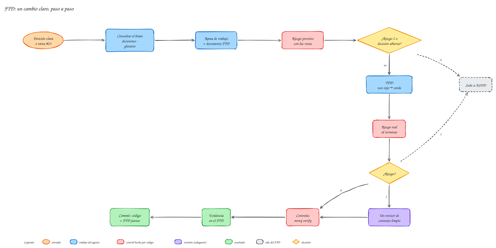
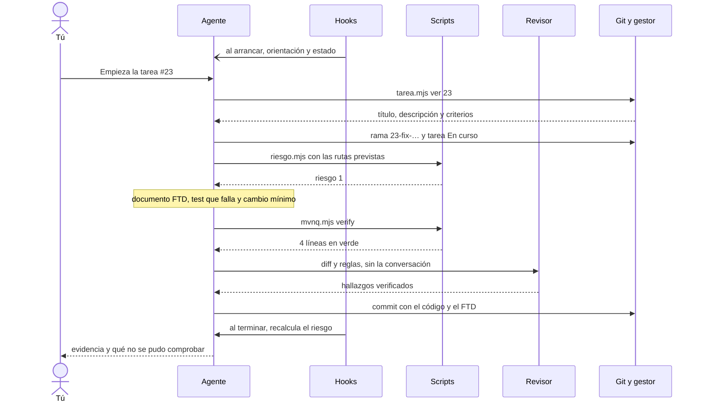

# FTD: cambios claros

En el tutorial hiciste un [FTD](../ayuda/glosario.md#ftd) completo en Spring PetClinic ([Tu primer cambio](../tutorial/primer-ftd.md)). Esta página añade tres cosas que el tutorial no trata: cuándo un FTD **no** es el [carril](../ayuda/glosario.md#carril), cómo empezar a partir de una tarea de GitHub Issues, Jira o GitLab («Empieza la tarea #23») y qué hace el agente cuando algo no sale como se esperaba.

## Los pasos, en resumen
{ .mh-diagrama }

1. Consulta el [brain](../ayuda/glosario.md#brain) (decisiones, glosario, lecciones).
2. Crea la rama si la base está protegida.
3. Escribe el documento FTD: intención, alcance, fuera de alcance y checklist con **la prueba de cada punto**.
4. Calcula el **[riesgo](../ayuda/glosario.md#riesgo) previsto** con los archivos que va a tocar.
5. Test que falla → cambio mínimo → test en verde.
6. Calcula el **riesgo real** con lo que de verdad cambió.
7. Pasa los controles (`mvnq verify` y los de la [constitución](../ayuda/glosario.md#constitucion)) y, con riesgo 1, un revisor.
8. Anota la evidencia y hace commit del código con el FTD.

### Quién hace cada cosa
El diagrama anterior dice **qué pasos** hay; este dice **quién habla con quién** en cada uno, con la tarea #23 del proyecto de reservas de viaje como ejemplo. Las flechas continuas son peticiones y las discontinuas, respuestas. En «Git y gestor», *gestor* es el [gestor de tareas](../ayuda/glosario.md#gestor-de-tareas) del proyecto (GitHub Issues, Jira o GitLab).



El documento vive en `brain/factory/ftd/<fecha>-<tema>.md`, se versiona con el código y queda en el brain como registro de por qué se hizo el cambio.

## Cuándo un FTD sube a ASDD
El agente para y propone pasar a [ASDD](../ayuda/glosario.md#asdd) si:

- aparece una **decisión que no le corresponde** («¿el cliente bloqueado puede reservar?»);
- lo pedido **contradice una decisión** guardada en el brain;
- el **riesgo previsto o real es 2**: un `.bpmn`, una migración, el `pom.xml`, la seguridad o la CI.

> [!example] En el proyecto de reservas de viaje: la tarea #23
> «Empieza la tarea #23» pedía cambiar los reintentos de una tarea de servicio en un `.bpmn`. El agente estimó **riesgo 1**, porque al empezar no había cambios que medir y no pasó la lista de archivos al script. Un `.bpmn` es riesgo 2. A raíz de esto, el agente calcula el riesgo **con las rutas previstas antes de tocar nada**, y un [hook](../ayuda/glosario.md#hook) lo vuelve a calcular al terminar cada respuesta por si se escapa algo.

## Trabajar desde una tarea del gestor
Si el proyecto tiene GitHub Issues, Jira o GitLab configurado, basta con el número:

```text
Empieza la tarea #23
```

El agente lee la tarea, crea la rama con el formato del proyecto (por ejemplo `23-fix-retries-validar-datos-entrada`), la marca como «En curso» con un comentario breve (carril, rama y documento) y enlaza el FTD (`tarea: 23`). Lo que la tarea no aclare va a los puntos abiertos, no a supuestos. Al abrir el [PR](../ayuda/glosario.md#pr) la pasa a «En revisión», y la cierra cuando el PR se integra o cuando tú lo pides. Qué puede hacer sin preguntarte (comentar, cambiar el estado, crear o cerrar) se decide al instalar; si algo no está permitido, te lo pide.

> [!example] En el proyecto de reservas de viaje: la tarea #51
> «Empieza la tarea #51» terminó sin tocar código: el agente leyó la tarea, revisó el código y el historial y vio que **ya estaba hecha** (había un commit con «(#51)»), aunque la tarea seguía abierta. No inventó trabajo: lo explicó y propuso cerrarla. Coste: 0,22 USD.

## Cuando algo sale en rojo
Un FTD no se cierra con «tests en verde», sino con **evidencia**, y lo que no se pudo comprobar se dice. En el proyecto de reservas de viaje se pidió un test de arquitectura ([ArchUnit](../ayuda/glosario.md#archunit)) que comprobara que el dominio no depende de Spring. El test encontró una violación real que no se había pedido arreglar, y el FTD lo reflejó así:

```markdown
## Checklist
- [x] dominio no depende de JPA — prueba: ArchitectureTest.dominio_no_depende_de_jpa (verde)
- [x] dominio no depende de Camunda — prueba: ArchitectureTest.dominio_no_depende_de_camunda (verde)
- [ ] dominio no depende de Spring — prueba: ArchitectureTest.dominio_no_depende_de_spring
      (ROJO: violación real, ver abajo)
- [ ] Controles: mvnq verify — no ejecutado

## Evidencia
> [!failure] Violación en producción (sin corregir por petición expresa)
> Cliente extiende AbstractAggregateRoot (Spring Data), acoplando el dominio a Spring.
> Salida: Tests run: 4, Failures: 1 — 3 violaciones, todas en Cliente.
```

Tres cosas que el agente **no** hizo: marcar como hecho lo que estaba en rojo, desactivar el test para que pasara y decir «pasado» de un control que no ejecutó. La constitución del proyecto lo prohíbe, y los revisores lo comprueban.

## Cuánto cuesta
| Tarea | Sin [meta-harness-factory](../ayuda/glosario.md#meta-harness) | Con meta-harness-factory |
|---|---|---|
| Test de arquitectura (proyecto de reservas de viaje) | 0,167 USD | 0,193 USD (+16 %) |
| Cambio en PetClinic, con revisor | — | 0,36 USD |

Con **meta-harness-factory** el FTD cuesta algo más, porque el agente escribe el documento y la evidencia y, con riesgo 1, lanza un revisor. A cambio, queda constancia de qué se hizo y cómo se comprobó, y un segundo par de ojos que no vio escribir el código.

Las cifras son lo que Claude Code informa al terminar, calculado con las tarifas de la API de Anthropic. En las dos pruebas trabajó **Sonnet 5.5**, tanto el agente principal como el revisor. Para hacerte una idea, estas son las tarifas por millón de [tokens](../ayuda/glosario.md#token) (noviembre de 2026):

| Modelo | Entrada | Salida | Lectura de caché | En meta-harness-factory |
|---|---|---|---|---|
| Haiku 5.5 | 0,10 USD | 0,50 USD | — | [subagentes](../ayuda/glosario.md#subagente) de tareas mecánicas: `explorador`, `ejecutor-tests` |
| Sonnet 5.5 | 2 USD | 10 USD | 0,10 USD | el modelo de las pruebas; desarrollador y revisores |
| Opus 5.5 | 4 USD | 20 USD | 0,20 USD | `especificador` (ASDD) |

Con Opus 5.5 como agente principal, el mismo FTD costaría en torno al doble. Si usas Claude Code con una suscripción Pro o Max no pagas por tarea: el gasto cuenta contra el límite de uso de tu plan.
