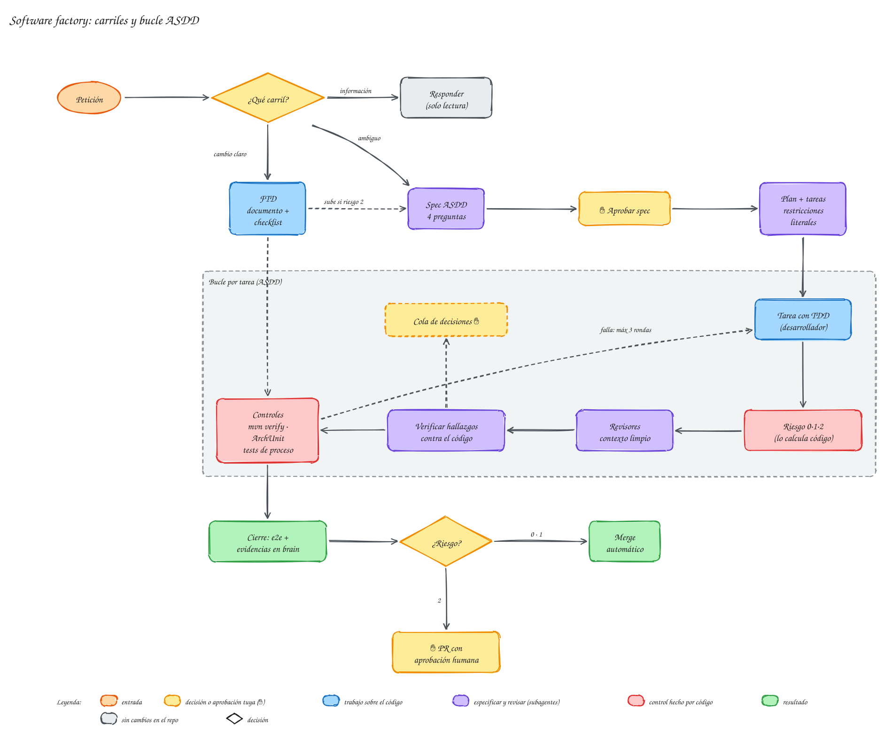

# Uso diario

En el tutorial hiciste un cambio de principio a fin. Esta sección explica cómo trabajar con **[meta-harness-factory](../ayuda/glosario.md#meta-harness)** cada día: qué [carril](../ayuda/glosario.md#carril) toma cada petición, cuándo te pregunta el agente y cuándo no, y cómo se controla el [riesgo](../ayuda/glosario.md#riesgo).

## Los tres carriles
Un **carril** es un camino de trabajo con sus pasos fijos, como los carriles de una autopista. El agente elige uno para cada petición según **lo clara que esté**, no según su tamaño, y te lo dice en una línea al empezar.

{ .mh-diagrama }

<small>Pulsa el diagrama para ampliarlo.</small>

| Carril | Cuándo | Qué queda escrito | Ejemplo |
|---|---|---|---|
| [**Responder**](responder.md) | preguntas: «¿dónde…?», «¿por qué…?», «¿qué pasa si…?» | nada | «¿qué worker procesa `activar-cliente`?» |
| [**FTD**](ftd.md) (*Fast Track Development*) | cambio claro, sin decisiones abiertas | un documento corto con checklist y evidencia | quitar una duplicación, corregir una validación |
| [**ASDD**](asdd.md) (*Agent Spec Driven Development*) | decisiones abiertas, ambigüedad o riesgo 2 | [spec](../ayuda/glosario.md#spec), plan, progreso y verificación | un subproceso nuevo, cambiar cómo fallan los workers |

Renombrar algo en cuarenta archivos sigue siendo [FTD](../ayuda/glosario.md#ftd): es mucho trabajo, pero no hay nada que decidir. Añadir un campo a una entidad con su migración de base de datos es [ASDD](../ayuda/glosario.md#asdd), aunque sean veinte líneas: hay que decidir el tipo de la columna, qué pasa con los datos que ya existen y si la migración se puede deshacer.

> [!tip] Puedes corregir el carril
> Si el agente elige mal, díselo: «esto hazlo como FTD» o «esto merece una spec». El carril es una propuesta, no una imposición. La única excepción es el **riesgo 2**: si el cambio toca archivos sensibles, el agente insistirá en ASDD y los [hooks](../ayuda/glosario.md#hook) no le dejarán subir el cambio sin una spec aprobada (ver [riesgo y revisión](riesgo-revision.md)).

## Dónde intervienes tú
**meta-harness-factory** está pensado para que el agente trabaje solo la mayor parte del tiempo y te pida criterio solo donde importa:

1. **Aprobar la spec** de un cambio ASDD, después de resolver sus puntos abiertos.
2. **Resolver la [cola de decisiones](../ayuda/glosario.md#cola-de-decisiones)** (`brain/factory/decisiones-pendientes.md`): lo que el agente no debe decidir solo. Lo marcado como `bloqueante` lo detiene; lo marcado como `revisar-después` lo deja seguir y lo revisas después.
3. **Aprobar el [PR](../ayuda/glosario.md#pr)** de un cambio de riesgo 2.

Todo lo demás (documentos, tests, revisión, evidencia, commits) lo hace el agente y lo deja escrito en el [brain](../ayuda/glosario.md#brain).

## Los ejemplos de esta sección
Además de Spring PetClinic, esta sección usa un **proyecto real** en el que se probó **meta-harness-factory**: seis microservicios Spring Boot con Camunda 8, [DDD](../ayuda/glosario.md#ddd) hexagonal y siete modelos [BPMN](../ayuda/glosario.md#bpmn-dmn), en adelante «el proyecto de reservas de viaje». Los textos, costes y documentos que verás salieron de esas pruebas; solo se han quitado los nombres propios.

## Consejos para el día a día
- **Una tarea por sesión** cuando el trabajo es largo. Al cambiar de tarea, `/clear`: el brain guarda lo importante y la siguiente sesión arranca orientada.
- **Pide la tarea, no los pasos.** «Corrige la validación de la fecha de nacimiento» basta; el carril ya sabe que hay que escribir el test primero.
- **«Recuérdalo»** guarda una decisión o una lección en el brain. La próxima sesión, y cualquier compañero, la tendrán.
- **Las preguntas son baratas, los cambios no.** Ante la duda, pregunta primero (carril Responder) y pide el cambio después.
